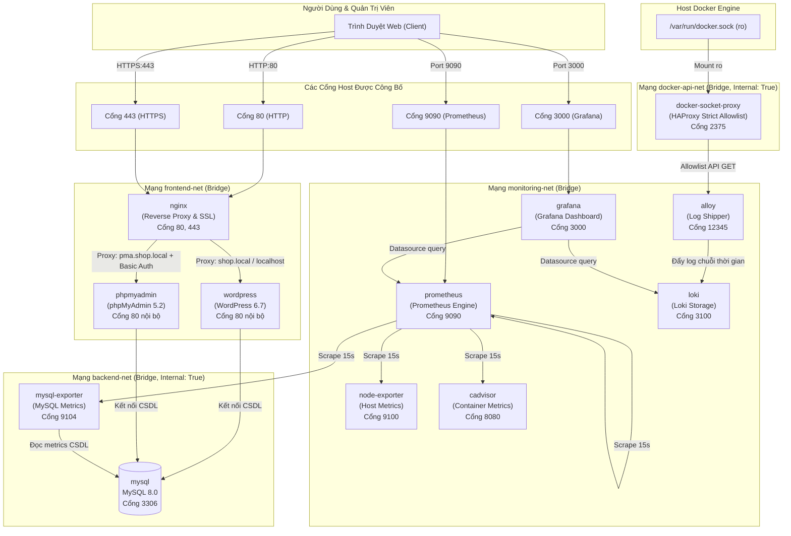

# ĐỀ TÀI SỐ 03: WEBSITE QUẢNG BÁ SẢN PHẨM BẰNG WORDPRESS
## HỆ THỐNG TRIỂN KHAI VÀ QUẢN TRỊ NỀN TẢNG CONTAINER HÓA (DOCKER COMPOSE)

> **Môn học:** Triển khai và Quản trị Hệ thống Phần mềm
> **Sinh viên thực hiện:** Nông Quốc Tuấn | **Mã sinh viên:** DTC245200059 | **Lớp:** KTPM K23C
> **Cơ sở đào tạo:** Trường Đại học Công nghệ Thông tin & Truyền thông — Đại học Thái Nguyên
> **Mã nguồn GitHub:** [https://github.com/dtc245200059-eng/DTC245200059-De-tai-03-TKVQTHTPM-Website-Quang-Ba-San-Pham-.git](https://github.com/dtc245200059-eng/DTC245200059-De-tai-03-TKVQTHTPM-Website-Quang-Ba-San-Pham-.git)

---

## MỤC LỤC

1. [Giới Thiệu Đề Tài & Công Nghệ](#1-giới-thiệu-đề-tài--công-nghệ)
2. [Kiến Trúc Hệ Thống & Mô Hình Phân Tầng](#2-kiến-trúc-hệ-thống--mô-hình-phân-tầng)
3. [Yêu Cầu Môi Trường & Tài Nguyên](#3-yêu-cầu-môi-trường--tài-nguyên)
4. [Cài Đặt & Cấu Hình Biến Môi Trường](#4-cài-đặt--cấu-hình-biến-môi-trường)
5. [Khởi Tạo Chứng Chỉ SSL/TLS & Xác Thực Basic Auth](#5-khởi-tạo-chứng-chỉ-ssltls--xác-thực-basic-auth)
6. [Quy Trình Khởi Chạy & Vận Hành Hệ Thống](#6-quy-trình-khởi-chạy--vận-hành-hệ-thống)
7. [Địa Chỉ Truy Cập & Thiết Lập Tên Miền (Hosts)](#7-địa-chỉ-truy-cập--thiết-lập-tên-miền-hosts)
8. [Kích Hoạt & Trải Nghiệm Giao Diện TechSmart](#8-kích-hoạt--trải-nghiệm-giao-diện-techsmart)
9. [Kiến Trúc An Toàn & Cơ Chế Hardening Bảo Mật](#9-kiến-trúc-an-toàn--cơ-chế-hardening-bảo-mật)
10. [Hệ Thống Giám Sát Metrics & Quản Trị Nhật Ký (Loki / Alloy)](#10-hệ-thống-giám-sát-metrics--quản-trị-nhật-ký-loki--alloy)
11. [Chiến Lược Sao Lưu & Khôi Phục Dữ Liệu (Backup & Recovery)](#11-chiến-lược-sao-lưu--khôi-phục-dữ-liệu-backup--recovery)
12. [Xử Lý Sự Cố Thường Gặp (Troubleshooting)](#12-xử-lý-sự-cố-thường-gặp-troubleshooting)
13. [Kiểm Thử Thực Tế & Ranh Giới Kỹ Thuật Hệ Thống](#13-kiểm-thử-thực-tế--ranh-giới-kỹ-thuật-hệ-thống)

---

## 1. GIỚI THIỆU ĐỀ TÀI & CÔNG NGHỆ

### 1.1. Mục tiêu đề tài
Đề tài số 03 tập trung xây dựng một hệ thống hoàn chỉnh phục vụ **quảng bá sản phẩm công nghệ (TechSmart)** trên nền tảng mã nguồn mở **WordPress 6.7**, đồng thời áp dụng toàn diện các nguyên lý kỹ thuật của môn học **Triển khai và Quản trị Hệ thống Phần mềm**:
- Container hóa 100% các thành phần bằng **Docker** và điều phối bằng **Docker Compose**.
- Thiết lập cổng truy cập duy nhất (**Single Entry Point**) qua **Nginx Reverse Proxy**, mã hóa **HTTPS (TLS 1.2/1.3)** và thiết lập các tiêu chuẩn an toàn máy chủ web.
- Quản trị cơ sở dữ liệu quan hệ **MySQL 8.0** qua giao diện trực quan **phpMyAdmin** được bảo vệ bằng hai lớp xác thực.
- Xây dựng hệ thống quan sát toàn diện (**Observability**): Thu thập chỉ số định lượng (**Metrics**) với **Prometheus**, trực quan hóa trên **Grafana**, và gom nhật ký tập trung (**Logs**) thời gian thực bằng **Grafana Loki** và **Grafana Alloy**.
- Hardening toàn diện hệ thống: Phân tách 4 mạng nội bộ, hạn chế Linux Capabilities (`cap_drop: [ALL]`), giới hạn tài nguyên CPU/RAM/PIDs, thiết lập quay vòng log cục bộ và cô lập Docker Socket API bằng **HAProxy Allowlist Proxy**.

### 1.2. Danh mục công nghệ chính
- **Web Server & Reverse Proxy:** Nginx 1.30.6-alpine
- **Ứng dụng CMS:** WordPress 6.7 (PHP 8.2 Apache)
- **Giao diện tùy biến:** TechSmart Custom Classic Theme (`website-quang-ba`)
- **Cơ sở dữ liệu:** MySQL Server 8.0 (caching_sha2_password, utf8mb4)
- **Quản trị CSDL:** phpMyAdmin 5.2-apache
- **Giám sát Metrics:** Prometheus v2.53.3, Node Exporter v1.8.2, cAdvisor v0.49.1, MySQLd Exporter v0.15.1
- **Trực quan hóa:** Grafana 11.1.0
- **Nhật ký tập trung (Logging):** Grafana Loki 3.7.9, Grafana Alloy v1.21.2
- **Tường lửa Docker API:** HAProxy 2.8.31-alpine (Strict Allowlist Proxy)

---

## 2. KIẾN TRÚC HỆ THỐNG & MÔ HÌNH PHÂN TẦNG

### 2.1. Mô hình tổng thể 12 dịch vụ
Hệ thống gồm đúng **12 container** độc lập, tương tác thông qua **4 mạng ảo nội bộ** và lưu trữ trên **6 named volumes**:



### 2.2. Phân biệt cấu hình Repository (Windows) và Runtime Ubuntu đã kiểm tra

Nhằm đảm bảo tính trung thực và minh bạch kỹ thuật, tài liệu phân định rõ sự khác biệt giữa cấu hình mã nguồn trong repository và hiện trạng môi trường máy chủ Ubuntu đã kiểm tra gần nhất:

- **Cấu hình trong Repository Windows (`docker-compose.yml`):**
  - Quản lý đầy đủ **12 dịch vụ**, **4 phân vùng mạng** (`frontend-net`, `backend-net`, `monitoring-net`, `docker-api-net`), và **6 named volumes** (`wordpress_data`, `db_data`, `prometheus_data`, `grafana_data`, `loki_data`, `alloy_data`).
  - Thiết lập ngân sách tài nguyên chi tiết cho toàn bộ 12 container: Hard Limit 3.584 MiB (~3.50 GiB) RAM, 6.20 CPU cores, 900 PIDs.
  - Cấu hình thu hẹp Linux Capabilities (`cap_drop: [ALL]`) cho 7 dịch vụ giám sát/logging.
  - Tích hợp kiến trúc gom log thế hệ mới: **HAProxy Docker Socket Proxy** (áp dụng chính sách deny-by-default) kết hợp **Grafana Alloy** thay thế Promtail.

- **Hiện trạng Runtime máy chủ Ubuntu đã kiểm tra gần nhất:**
  - Thư mục làm việc: `/home/tuan123/de-03-wordpress`, sử dụng tệp `compose.yml`.
  - Đang vận hành **10 container** gồm: `cadvisor`, `database` (MySQL), `grafana`, `loki`, `nginx`, `node-exporter`, `phpmyadmin`, `prometheus`, `promtail` và `wordpress`.
  - Đã có logging driver `json-file` với `max-size: 10m`, `max-file: 3`; giao diện theme được gắn kết dạng bind mount chỉ đọc (`:ro`).
  - Container cAdvisor đang chạy với cờ `privileged: true`.
  - **Theo các bằng chứng đo lường hiện có, các giới hạn tài nguyên RAM/CPU/PID của cấu hình Windows chưa được áp dụng lên runtime Ubuntu; hệ thống trên Ubuntu chưa chạy đủ 12 dịch vụ và chưa có thành phần HAProxy socket proxy hay Alloy.**

### 2.3. Phân vùng mạng nội bộ (Network Isolation)
1. **`frontend-net`** (bridge): Mạng giao tiếp giữa điểm tiếp nhận Nginx và các dịch vụ giao diện web (`wordpress`, `phpmyadmin`).
2. **`backend-net`** (bridge, `internal: true`): Mạng dữ liệu cô lập tuyệt đối khỏi Internet. Chỉ có `wordpress`, `phpmyadmin`, `mysql` và `mysql-exporter` tham gia. Không container nào từ bên ngoài có thể gửi gói tin trực tiếp tới CSDL.
3. **`monitoring-net`** (bridge): Mạng dành riêng cho hệ sinh thái quan sát (`prometheus`, `grafana`, `node-exporter`, `cadvisor`, `mysql-exporter`, `loki`, `alloy`).
4. **`docker-api-net`** (bridge, `internal: true`): Mạng nội bộ bảo mật cao chỉ kết nối `alloy` với `docker-socket-proxy`. Tuyệt đối không publish cổng 2375 ra host.

### 2.4. Danh mục lưu trữ bền vững (Named Volumes)
- **`wordpress_data`**: Lưu trữ mã nguồn core, tệp upload `wp-content/uploads/` và cấu hình WordPress.
- **`db_data`**: Lưu trữ toàn bộ bảng dữ liệu InnoDB của MySQL tại `/var/lib/mysql`.
- **`prometheus_data`**: Lưu trữ cơ sở dữ liệu chuỗi thời gian TSDB với chu kỳ lưu giữ 15 ngày (`retention: 15d`).
- **`grafana_data`**: Lưu trữ cơ sở dữ liệu nội bộ SQLite, người dùng, phiên làm việc và dashboards của Grafana.
- **`loki_data`**: Lưu trữ chunks nhật ký và chỉ mục TSDB của Loki tại `/loki`.
- **`alloy_data`**: Lưu trữ con trỏ vị trí (offsets/positions) đọc nhật ký của Alloy tại `/var/lib/alloy/data`.

---

## 3. YÊU CẦU MÔI TRƯỜNG & TÀI NGUYÊN

### 3.1. Phần mềm yêu cầu
- **Hệ điều hành:**
  - Ubuntu Server 22.04 LTS / 24.04 LTS (khuyến nghị trên môi trường triển khai thực tế).
  - Windows 10/11 Pro/Enterprise có cài đặt Docker Desktop (WSL 2 backend).
- **Docker Engine:** Phiên bản `>= 24.0` (khuyến nghị 26.x trở lên).
- **Docker Compose:** Phiên bản `v2.20` trở lên (sử dụng cú pháp lệnh chuẩn `docker compose`, không dùng `docker-compose` v1 di sản).
- **Công cụ phụ trợ:** `openssl` (sinh chứng chỉ tự ký), `curl` hoặc `wget` (kiểm tra endpoint), `git`.

### 3.2. Cấu hình tài nguyên phần cứng (Resource Budget)
Hệ thống trong repository được thiết lập ngân sách tài nguyên (`mem_reservation`, `mem_limit`, `cpus`, `pids_limit`) cho 12 container trong `docker-compose.yml`:
- **Tổng Memory Hard Limit (Chặn cứng):** `3.584 MB` (~3.50 GiB).
- **Tổng Memory Soft Limit (Đảm bảo tối thiểu):** `1.704 MB` (~1.66 GiB).
- **Tổng CPU Quota:** `6.20 cores`.
- **Tổng PIDs Limit:** `900 PIDs`.

> [!NOTE]
> **Đối chiếu với cấu hình máy chủ Ubuntu đã đo thực tế:** 8 vCPU, 6.2 GiB RAM (4.9 GiB khả dụng), Swap 4 GiB, đĩa trống 33 GB.
> - Mức Hard Limit 3.50 GiB của repository tương đương khoảng **71,4%** RAM khả dụng (3,50 GiB / 4,9 GiB), để lại hơn 1.3 GiB dự phòng an toàn cho Linux Kernel, Systemd, Docker daemon và Page Cache.
> - *Lưu ý quan trọng:* Toàn bộ các thông số giới hạn RAM, CPU và PIDs này hiện mới được thiết lập trong tệp `docker-compose.yml` của repository Windows và chưa được áp dụng lên runtime máy chủ Ubuntu (vốn đang chạy 10 container với `compose.yml` tại `/home/tuan123/de-03-wordpress`).

---

## 4. CÀI ĐẶT & CẤU HÌNH BIẾN MÔI TRƯỜNG

### 4.1. Tải mã nguồn dự án
```bash
# Clone repository về máy
git clone https://github.com/dtc245200059-eng/DTC245200059-De-tai-03-TKVQTHTPM-Website-Quang-Ba-San-Pham-.git de-tai-03
cd de-tai-03
```

### 4.2. Khởi tạo tệp `.env` từ `.env.example`
Mã nguồn dự án tuân thủ nghiêm ngặt quy tắc an toàn: tệp `.env` thật chứa mật khẩu **không được đưa lên Git** (đã cấu hình trong `.gitignore`). Bạn cần tạo tệp `.env` riêng trước khi chạy:

**Trên Linux / macOS:**
```bash
cp .env.example .env
chmod 600 .env
```

**Trên Windows PowerShell:**
```powershell
Copy-Item .env.example .env
```

### 4.3. Danh mục các biến môi trường cần thiết lập
Mở tệp `.env` và thay đổi các chuỗi mật khẩu mẫu bằng mật khẩu phức tạp:

| Tên biến môi trường | Mô tả chức năng | Khuyến nghị giá trị |
| :--- | :--- | :--- |
| `MYSQL_ROOT_PASSWORD` | Mật khẩu tài khoản `root` của MySQL | Chuỗi ký tự ngẫu nhiên phức tạp (`>= 16 ký tự`) |
| `MYSQL_DATABASE` | Tên CSDL dùng cho WordPress | `wordpress_db` |
| `MYSQL_USER` | Tên tài khoản ứng dụng WordPress kết nối CSDL | `wp_app_user` (tuân thủ nguyên tắc least privilege) |
| `MYSQL_PASSWORD` | Mật khẩu tài khoản ứng dụng WordPress | Chuỗi ký tự mạnh, khác với root password |
| `WORDPRESS_TABLE_PREFIX` | Tiền tố bảng cơ sở dữ liệu WordPress | `wp_` |
| `WORDPRESS_DEBUG` | Chế độ debug của WordPress | `0` (tắt khi triển khai, `1` khi phát triển) |
| `PMA_ARBITRARY` | Cho phép phpMyAdmin kết nối server CSDL tùy tiện | `0` (khóa cứng kết nối, chỉ cho phép kết nối tới MySQL nội bộ) |
| `GRAFANA_ADMIN_USER` | Tên tài khoản quản trị cao nhất của Grafana | `admin` |
| `GRAFANA_ADMIN_PASSWORD` | Mật khẩu quản trị Grafana | Mật khẩu mạnh dùng để đăng nhập Grafana Web UI |
| `MYSQL_EXPORTER_USER` | Tên tài khoản giám sát CSDL cho Exporter | `exporter` (được cấp quyền đọc SELECT ON *.* qua init script) |
| `MYSQL_EXPORTER_PASSWORD` | Mật khẩu tài khoản giám sát MySQL | Chuỗi ký tự mạnh riêng biệt |

---

## 5. KHỞI TẠO CHỨNG CHỈ SSL/TLS & XÁC THỰC BASIC AUTH

Trước khi khởi động Docker Compose, cần chuẩn bị cặp khóa SSL/TLS tự ký và tệp xác thực quản trị:

### 5.1. Khởi tạo cặp khóa SSL/TLS tự ký
Script [`scripts/generate-ssl.sh`](file:///d:/Đề_3-DTC245200059/scripts/generate-ssl.sh) tự động tạo cặp chứng chỉ RSA 2048-bit có cấu hình **SAN (Subject Alternative Name)** cho các tên miền `shop.local`, `pma.shop.local`, `localhost`, `127.0.0.1`:

**Trên Linux / Ubuntu:**
```bash
chmod +x scripts/generate-ssl.sh
./scripts/generate-ssl.sh
```

**Trên Windows (nếu có Git Bash hoặc WSL):**
```bash
bash scripts/generate-ssl.sh
```

*Nếu chạy trên môi trường Windows PowerShell thuần túy không có OpenSSL CLI:* Bạn có thể sử dụng container tạm thời để tạo chứng chỉ:
```powershell
docker run --rm -v "${PWD}/nginx/ssl:/certs" alpine/openssl req -x509 -nodes -days 365 -newkey rsa:2048 -keyout /certs/selfsigned.key -out /certs/selfsigned.crt -subj "/C=VN/ST=ThaiNguyen/L=ThaiNguyen/O=ICTU/OU=DTC245200059/CN=shop.local" -addext "subjectAltName=DNS:shop.local,DNS:pma.shop.local,DNS:localhost,IP:127.0.0.1"
```

### 5.2. Khởi tạo tệp xác thực HTTP Basic Auth cho phpMyAdmin
Tệp `nginx/.htpasswd` dùng để bảo vệ cổng quản trị phpMyAdmin tại tầng Nginx Reverse Proxy (trước khi người dùng thấy màn hình đăng nhập của MySQL).

**Cách 1: Sử dụng công cụ `htpasswd` (nếu có sẵn gói `apache2-utils`):**
```bash
# Khởi tạo tệp và nhập mật khẩu tương tác (không lưu mật khẩu vào history):
htpasswd -c nginx/.htpasswd admin_pma
chmod 600 nginx/.htpasswd
```

**Cách 2: Sử dụng Docker container tạm thời (tiện lợi trên mọi hệ điều hành):**
```bash
# Trên Linux / macOS:
docker run --rm -it -v "${PWD}/nginx:/etc/nginx" httpd:alpine htpasswd -c /etc/nginx/.htpasswd admin_pma

# Trên Windows PowerShell:
docker run --rm -it -v "${PWD}/nginx:/etc/nginx" httpd:alpine htpasswd -c /etc/nginx/.htpasswd admin_pma
```
*(Hệ thống sẽ yêu cầu nhập `New password:` và xác nhận lại `Re-type new password:`. Nhập mật khẩu mong muốn để tạo tài khoản).*

---

## 6. QUY TRÌNH KHỞI CHẠY & VẬN HÀNH HỆ THỐNG

### 6.1. Kiểm tra tính hợp lệ của tệp Compose
Trước khi khởi động, luôn kiểm tra cú pháp và biến môi trường:
```bash
docker compose config
```
*Lệnh này hiển thị toàn bộ cấu hình đã được render hoàn chỉnh. Nếu có lỗi cú pháp hoặc thiếu biến môi trường, Docker Compose sẽ báo lỗi chi tiết.*

### 6.2. Khởi chạy toàn bộ 12 dịch vụ ở chế độ chạy nền
```bash
docker compose up -d
```

### 6.3. Kiểm tra trạng thái vận hành của các container
```bash
docker compose ps
```
*Tất cả các container có cấu hình Healthcheck (`nginx`, `wordpress`, `mysql`, `phpmyadmin`, `prometheus`, `grafana`, `node-exporter`, `cadvisor`, `mysql-exporter`, `loki`, `alloy`, `docker-socket-proxy`) phải hiển thị trạng thái `Up (healthy)`.*

### 6.4. Xem nhật ký (Logs) của hệ thống
```bash
# Xem log toàn bộ hệ thống theo thời gian thực:
docker compose logs -f

# Xem log của một dịch vụ cụ thể (ví dụ Nginx hoặc WordPress):
docker compose logs -f nginx
docker compose logs -f wordpress
docker compose logs -f mysql
```

### 6.5. Dừng hệ thống an toàn (Bảo toàn dữ liệu)
```bash
docker compose down
```
> [!CAUTION]
> **CẢNH BÁO MẤT DỮ LIỆU:** Tuyệt đối **KHÔNG sử dụng** `docker compose down -v` trong các thao tác vận hành thông thường. Cờ `-v` (volumes) sẽ **xóa sạch vĩnh viễn** toàn bộ cơ sở dữ liệu MySQL (`db_data`), bài viết, ảnh tải lên của WordPress (`wordpress_data`) và toàn bộ kho metrics/logs lịch sử!

---

## 7. ĐỊA CHỈ TRUY CẬP & THIẾT LẬP TÊN MIỀN (HOSTS)

### 7.1. Bảng phân bổ cổng và địa chỉ truy cập dịch vụ

| Dịch vụ | Tên miền / URL | Cổng Host | Giao thức | Cơ chế bảo vệ & Xác thực |
| :--- | :--- | :---: | :---: | :--- |
| **Website TechSmart** | `https://shop.local/` | `443` | HTTPS (TLS 1.2/1.3) | Single Entry Point Nginx; HTTP 80 tự chuyển hướng 301 sang HTTPS. Rate limiting trên `/wp-login.php`. |
| **Trang Quản trị WordPress** | `https://shop.local/wp-admin/` | `443` | HTTPS | Tài khoản quản trị WordPress thiết lập tại bước cài đặt CMS. |
| **phpMyAdmin Web UI** | `https://pma.shop.local/` | `443` | HTTPS | **2 Lớp xác thực:**<br>1. HTTP Basic Auth tại Nginx (`nginx/.htpasswd`).<br>2. Đăng nhập MySQL (`root` hoặc `wp_app_user`). |
| **Truy cập Cục bộ (Alias)** | `https://localhost/` | `443` | HTTPS | Hỗ trợ demo nhanh không cần chỉnh sửa tệp hosts. Định tuyến trực tiếp về WordPress. |
| **Grafana Dashboard** | `http://<HOST_IP>:3000/` | `3000` | HTTP | Đăng nhập tài khoản `GRAFANA_ADMIN_USER` / `GRAFANA_ADMIN_PASSWORD` từ `.env`. |
| **Prometheus Web UI** | `http://<HOST_IP>:9090/` | `9090` | HTTP | Truy cập trực tiếp; kiểm tra 4 Scrape Targets tại mục `Status` -> `Targets`. |
| **Host Lạ / Quét IP Trực tiếp** | `http(s)://<IP_HOST>/` | `80/443` | HTTP/HTTPS | **Bị từ chối ngay lập tức (HTTP 444)** bởi default catch-all server block, chống tấn công Host Header Injection. |

### 7.2. Hướng dẫn thiết lập tệp `hosts`
Để truy cập các tên miền ảo `shop.local` và `pma.shop.local`, máy tính dùng trình duyệt cần ánh xạ tên miền về địa chỉ IP của máy chủ Docker:

- **Nếu chạy Docker trực tiếp trên máy Windows:** IP máy chủ là `127.0.0.1`.
- **Nếu chạy Docker trên máy ảo Ubuntu (VMware / VirtualBox):** IP máy chủ là địa chỉ IP của máy ảo (kiểm tra bằng lệnh `hostname -I` hoặc `ip -br a` trên Ubuntu, ví dụ `192.168.206.128`).

#### Cấu hình trên Windows:
1. Mở Notepad với quyền Administrator (**Run as Administrator**).
2. Mở tệp: `C:\Windows\System32\drivers\etc\hosts` (chuyển bộ lọc góc dưới thành *All Files \*.\**).
3. Thêm dòng sau vào cuối tệp:
   ```text
   # Ánh xạ tên miền Đề tài số 03 (Thay 127.0.0.1 bằng IP máy ảo Ubuntu nếu chạy qua VMware)
   127.0.0.1 shop.local pma.shop.local
   ```
4. Nhấn `Ctrl + S` để lưu tệp.

#### Cấu hình trên Linux / macOS:
```bash
sudo nano /etc/hosts
# Thêm dòng sau và lưu lại (Ctrl+O, Enter, Ctrl+X):
127.0.0.1 shop.local pma.shop.local
```

### 7.3. Hướng dẫn xử lý cảnh báo chứng chỉ SSL tự ký (Self-Signed)

Trong khuôn khổ đồ án môn học, hệ thống sử dụng chứng chỉ SSL/TLS tự ký (Self-Signed Certificate) để thiết lập và kiểm thử kênh truyền mã hóa HTTPS nội bộ mà không phát sinh chi phí đăng ký tên miền công cộng và chứng thư CA thương mại.

> [!WARNING]
> **NGUYÊN TẮC AN TOÀN BẢO MẬT VỀ CHỨNG CHỈ SỐ:**
> - Thao tác tiếp tục qua cảnh báo chứng chỉ của trình duyệt **chỉ được phép thực hiện khi đã xác minh đúng hostname dự kiến** (`shop.local`, `pma.shop.local`, `localhost`) và **đúng địa chỉ máy chủ lab** (máy cục bộ `127.0.0.1` hoặc IP máy ảo Ubuntu được phân công).
> - **Tuyệt đối không coi việc bỏ qua cảnh báo chứng chỉ là một thực hành an toàn** cho website công khai trên Internet hoặc khi xử lý các dữ liệu nhạy cảm thực tế. Trên môi trường sản xuất (Production), máy chủ bắt buộc phải sử dụng chứng chỉ số hợp lệ do cơ quan chứng thực công cộng (như Let's Encrypt hoặc Commercial CA) cấp phát để phòng chống triệt để tấn công giả mạo và nghe lén Man-in-the-Middle (MitM).

**Quy trình truy cập demo trên trình duyệt (Chrome / Edge / Firefox):**
1. Khi truy cập `https://shop.local/` hoặc `https://pma.shop.local/`, trình duyệt sẽ hiển thị thông báo cảnh báo: **"Your connection is not private"** (Kết nối của bạn không phải là kết nối riêng tư) hoặc `NET::ERR_CERT_AUTHORITY_INVALID` do chứng chỉ tự ký không thuộc chuỗi ủy thác CA mặc định.
2. Kiểm tra thanh địa chỉ để xác minh chính xác hostname và IP máy chủ lab.
3. Nhấn vào nút **Advanced** (Nâng cao).
4. Nhấn liên kết **"Proceed to shop.local (unsafe)"** (Tiếp tục truy cập shop.local).
5. Trình duyệt sẽ hoàn tất bắt tay TLS và tải giao diện web qua kênh truyền mã hóa.

---

## 8. KÍCH HOẠT & TRẢI NGHIỆM GIAO DIỆN TECHSMART

### 8.1. Cấu trúc Theme tùy chỉnh
Giao diện **TechSmart** được thiết kế độc quyền phục vụ đồ án, đặt tại thư mục:\
[`wordpress-theme/website-quang-ba/`](file:///d:/Đề_3-DTC245200059/wordpress-theme/website-quang-ba/)

Theme được tích hợp vào container WordPress thông qua cơ chế **bind mount chỉ đọc (`:ro`)** trong `docker-compose.yml`:
```yaml
volumes:
  - wordpress_data:/var/www/html
  - ./wordpress-theme/website-quang-ba:/var/www/html/wp-content/themes/website-quang-ba:ro
```
*Cờ `:ro` (read-only) bảo vệ tuyệt đối mã nguồn giao diện khỏi việc bị sửa đổi trái phép hoặc chèn backdoor từ bên trong môi trường container.*

### 8.2. Quy trình kích hoạt giao diện
Việc mount thư mục theme không đồng nghĩa với việc theme tự động kích hoạt. Cần thực hiện kích hoạt theo một trong hai cách:

#### Cách 1: Kích hoạt qua giao diện WordPress Admin (Khuyến nghị)
1. Đăng nhập trang quản trị: `https://shop.local/wp-admin/` (hoặc `https://localhost/wp-admin/`).
2. Điều hướng tới menu bên trái: **Appearance** (Giao diện) -> **Themes** (Giao diện).
3. Tìm theme mang tên **Website Quảng Bá Sản Phẩm - Đề Tài 03** (nhận diện qua ảnh chụp preview TechSmart).
4. Nhấn nút **Activate** (Kích hoạt).

#### Cách 2: Kích hoạt nhanh qua WP-CLI (nếu container có sẵn WP-CLI)
```bash
docker compose exec wordpress wp theme activate website-quang-ba --allow-root
```

### 8.3. Các thành phần giao diện chính trên trang chủ
1. **Hero Showcase Section (`#hero`):** Biểu ngữ công nghệ với tiêu đề nổi bật, nút kêu gọi hành động (CTA) kép, thanh chỉ số tin cậy và hình ảnh vector SVG độc lập.
2. **Featured Products Grid (`#san-pham`):** 6 thiết bị IoT tiêu biểu (Smart Hub, UltraSensor, CyberEdge Gateway, VisionAI Cam, PowerGuard UPS, SmartTag) hiển thị giá, nhãn nổi bật, thông số chip tóm tắt và nút xem chi tiết.
3. **Category Filter Tabs:** Bộ lọc JavaScript không tải lại trang với 6 tab (Tất cả, Thiết bị trung tâm, Cảm biến, Bảo mật & mạng, Camera AI, Nguồn & phụ kiện).
4. **Quick View Modal Dialog:** Hộp thoại xem nhanh thông số kỹ thuật mở bằng nút "Xem Chi Tiết", hỗ trợ đóng bằng nút bấm `X`, nhấn vùng backdrop bên ngoài hoặc phím `ESC`.
5. **Core Pillars & Architecture (`#tinh-nang`, `#ve-chung-toi`):** Khối giới thiệu 4 ưu thế vượt trội và bảng thông số hạ tầng (12 Dịch vụ Container, 4 Phân vùng mạng, Dữ liệu mô phỏng).
6. **Inquiry Form (`#lien-he`):** Form đăng ký nhận tư vấn và báo giá.

> [!IMPORTANT]
> **LÀM RÕ CHỨC NĂNG FORM TƯ VẤN (DEMO UI):**\
> Form liên hệ hiện tại là **thành phần mô phỏng giao diện người dùng (Client-Side UI Demo)** được xử lý bằng JavaScript tại trình duyệt. Do đồ án chưa tích hợp backend API, cơ sở dữ liệu lưu trữ đơn liên hệ hay dịch vụ gửi email SMTP, **dữ liệu sau khi nhập sẽ không được gửi hoặc lưu trữ tại máy chủ**. Khi người dùng gửi form, hệ thống hiển thị thông báo Toast xác nhận rõ tính chất demo này.

---

## 9. KIẾN TRÚC AN TOÀN & CƠ CHẾ HARDENING BẢO MẬT

Hệ thống triển khai mô hình phòng thủ chiều sâu (**Defense-in-Depth**) qua nhiều tầng bảo vệ:

### 9.1. Quản lý bí mật & Kiểm soát Git
- Tệp `.env` chứa mật khẩu thật và các tệp chứng chỉ khóa riêng tư `nginx/ssl/*.key`, `nginx/ssl/*.crt`, `nginx/.htpasswd` được loại trừ hoàn toàn khỏi Git bằng `.gitignore`.
- Chỉ lưu trữ các tệp mẫu `.env.example` và `nginx/.htpasswd.example` trên kho mã nguồn công khai.

### 9.2. Hardening Nginx Reverse Proxy
- **Chặn quét IP trực tiếp (Default Server 444):** Khối `server { listen 80 default_server; listen 443 ssl default_server; server_name _; return 444; }` ngắt kết nối ngay lập tức khi phát hiện truy vấn không rõ Host header.
- **Giới hạn tốc độ đăng nhập (Rate Limiting):** Cấu hình `limit_req_zone $binary_remote_addr zone=wp_login:10m rate=5r/s;` với `burst=10 nodelay` tại `location = /wp-login.php`. Khi vượt quá tần suất, Nginx trả về mã lỗi **HTTP 429 Too Many Requests**, làm chậm đáng kể các cuộc tấn công dò mật khẩu đơn nguồn.
- **Vô hiệu hóa XML-RPC:** Khối `location = /xmlrpc.php { deny all; return 403; }` chặn đứng hoàn toàn nguy cơ Pingback Reflection DDoS và tấn công brute-force đa luồng `system.multicall`.
- **Ẩn thông tin phiên bản:** Khai báo `server_tokens off;` ngăn chặn lộ phiên bản Nginx trong HTTP response headers.
- **HTTP Security Headers toàn cục:**
  - `X-Content-Type-Options: nosniff`: Chống tấn công khai thác kiểu nội dung MIME-sniffing.
  - `X-Frame-Options: SAMEORIGIN`: Chống tấn công Clickjacking.
  - `Referrer-Policy: strict-origin-when-cross-origin`: Bảo vệ thông tin URL nguồn khi chuyển hướng.
  - `Permissions-Policy: camera=(), microphone=(), geolocation=()`: Khóa quyền truy cập phần cứng nhạy cảm.
  - `Content-Security-Policy-Report-Only`: Khai báo chính sách bảo vệ tài nguyên ở chế độ giám sát.

### 9.3. Giới hạn bề mặt Docker API với HAProxy Socket Proxy (Chính sách Deny-by-Default)

Trong các giải pháp giám sát sử dụng proxy Docker socket (tiêu biểu như image `tecnativa/docker-socket-proxy` đến phiên bản 0.5.0), việc cấu hình các biến môi trường như `CONTAINERS=1, POST=0` nhằm mục đích ngăn chặn các phương thức ghi (POST/DELETE). Tuy nhiên, trong điều kiện cấu hình cụ thể đó, toàn bộ namespace `/containers/*` vẫn mở đối với các yêu cầu `GET`:
- Kẻ tấn công hoặc container bị chiếm quyền vẫn có thể gửi `GET /containers/{id}/archive` để đọc trộm tệp tin bất kỳ trong container (như `/etc/shadow`, khóa riêng tư, tệp cấu hình).
- Có thể gửi `GET /containers/{id}/export` để tải dump toàn bộ filesystem container.
- Có thể gửi `GET /containers/{id}/top` để theo dõi các tiến trình nội bộ đang chạy trên host.

Nhằm giảm thiểu bề mặt tấn công này, cấu hình repository Windows đề xuất giải pháp **giới hạn bề mặt API theo nguyên tắc Deny-by-Default** sử dụng **HAProxy 2.8-alpine** (`docker-socket-proxy/haproxy.cfg`):
- **Chỉ chấp nhận các HTTP method an toàn:** Chỉ cho phép `GET` và `HEAD`. Chặn `403 Forbidden` ngay lập tức mọi phương thức ghi `POST`, `PUT`, `DELETE`, `PATCH`.
- **Khai báo Allowlist 5 endpoint tối thiểu phục vụ thu thập log của Grafana Alloy:**
  1. `GET /_ping`: Kiểm tra liveness của Docker daemon.
  2. `GET /version`: Đọc phiên bản Docker API trong quá trình bắt tay ban đầu.
  3. `GET /containers/json`: Liệt kê danh sách container cho cơ chế auto-discovery.
  4. `GET /containers/{id}/logs`: Thu thập luồng log container stdout/stderr.
  5. `GET /containers/{id}/json`: Đọc metadata container phục vụ gán nhãn log.
- **Quy tắc Deny-by-Default:** Mặc định từ chối (`403 Forbidden`) tất cả các endpoint còn lại, bao gồm các đường dẫn nhạy cảm `/containers/{id}/archive`, `/export`, `/top`, `/attach`, `/exec`, `/images`, `/volumes`, `/networks`.

> [!NOTE]
> **RANH GIỚI KỸ THUẬT & YÊU CẦU XÁC MINH RUNTIME:**
> - Dự án **không khẳng định cấu hình HAProxy riêng đã khắc phục hoàn toàn CVE-2026-78122** khi chưa có bằng chứng kiểm thử và chứng minh bằng allowlist thực nghiệm rằng các endpoint nhạy cảm (như `/archive`, `/export`, `/top`) bị chặn hoàn toàn mà không có đường vòng bypass.
> - Đây là biện pháp giới hạn bề mặt API theo nguyên tắc deny-by-default được thiết lập tĩnh trong repository `docker-compose.yml` (Windows). Thành phần này chưa được triển khai trên runtime Ubuntu (hiện đang dùng Promtail đọc trực tiếp). Toàn bộ các endpoint và hành vi của allowlist cần được xác minh runtime trên môi trường thực tế.

### 9.4. Thu hẹp Linux Capabilities (`cap_drop: [ALL]`)
Toàn bộ 7 dịch vụ giám sát và logging (`prometheus`, `grafana`, `node-exporter`, `mysql-exporter`, `loki`, `alloy`, `docker-socket-proxy`) được cấu hình `cap_drop: [ALL]`.
- Loại bỏ toàn bộ các đặc quyền kernel cấp phát mặc định cho container.
- Tiến trình chỉ chạy với quyền hạn tối thiểu của tiến trình unprivileged.

> [!WARNING]
> **LƯU Ý VỀ CADVISOR TRÊN MÔI TRƯỜNG UBUNTU:**\
> Để đọc trực tiếp số liệu cgroups v2 và thống kê đĩa của host, cAdvisor trên môi trường triển khai thực tế Ubuntu cần chạy với cờ `privileged: true`. Đây là ngoại lệ vận hành đã được ghi nhận và khoanh vùng độc lập trong mạng nội bộ `monitoring-net`. Trong mã nguồn Compose repo Windows, cAdvisor được khai báo với `security_opt: no-new-privileges:true`.

---

## 10. HỆ THỐNG GIÁM SÁT METRICS & QUẢN TRỊ NHẬT KÝ (LOKI / ALLOY)

### 10.1. Giám sát định lượng (Prometheus Metrics)
Prometheus tự động thu thập chỉ số định kỳ mỗi **15 giây** từ 4 Scrape Targets:
1. `prometheus` (`localhost:9090`): Giám sát hiệu năng và dung lượng TSDB của chính máy chủ Prometheus.
2. `node-exporter` (`node-exporter:9100`): Giám sát CPU host, tỷ lệ dùng RAM, dung lượng phân vùng gốc `/`, I/O mạng và Load Average.
3. `cadvisor` (`cadvisor:8080`): Giám sát mức chiếm dụng CPU, Memory Working Set, I/O mạng của từng container Docker.
4. `mysql-exporter` (`mysql-exporter:9104`): Giám sát kết nối CSDL, QPS (Queries Per Second), lưu lượng InnoDB buffer pool và truy vấn chậm (Slow Queries).

### 10.2. Bảng điều khiển Grafana Dashboards nạp tự động (Provisioning)
Hệ thống nạp sẵn tự động 3 Dashboard chuẩn hóa trong thư mục **`WordPress System Monitoring`**:
- **`01. Giám sát Máy chủ (Host Infrastructure)`** (UID: `host-monitoring`): CPU Usage %, RAM Usage %, Root Disk %, System Uptime, CPU per Core.
- **`02. Giám sát Container (cAdvisor)`** (UID: `container-monitoring`): Số lượng container, CPU % từng container, Memory Working Set, Network Traffic RX/TX.
- **`03. Giám sát Cơ sở dữ liệu (MySQL Overview)`** (UID: `mysql-monitoring`): Trạng thái `mysql_up`, Queries Per Second, Active Threads, Connections, InnoDB Buffer Pool.

### 10.3. Quản trị nhật ký tập trung (Grafana Loki & Alloy)
Grafana Alloy tự động phát hiện các container đang chạy qua Socket Proxy và đẩy luồng nhật ký về Loki:
- **Truy cập Explore:** Mở `http://<HOST_IP>:3000/explore` và chọn nguồn dữ liệu **`Loki`**.
- **Bộ nhãn chuẩn hóa:** `container`, `service`, `stream` (stdout/stderr), `project` (`de-03-wordpress`), `environment` (`demo`).

#### Các câu truy vấn LogQL mẫu phục vụ kiểm thử:
```logql
# 1. Xem toàn bộ nhật ký truy cập HTTP đi qua Nginx:
{container="nginx"} |= "GET"

# 2. Phát hiện lỗi và cảnh báo trên WordPress và Nginx:
{container=~"wordpress|nginx"} |~ "(?i)(error|failed|404|500)"

# 3. Theo dõi các truy vấn và thông báo bảo mật của MySQL:
{container="mysql"} |= "Access denied"

# 4. Đếm số lượng dòng log cảnh báo theo thời gian (LogQL Metrics):
sum by (container) (count_over_time({container=~"wordpress|nginx|mysql"} |~ "(?i)(error|failed)" [5m]))
```

### 10.4. Quay vòng log cục bộ (Docker Log Rotation)
Toàn bộ 12 dịch vụ đều được cấu hình xoay vòng log cục bộ qua driver `json-file`:
```yaml
logging:
  driver: "json-file"
  options:
    max-size: "10m"
    max-file: "3"
```
*Mỗi container lưu tối đa 3 tệp x 10 MB = 30 MB log cục bộ trên đĩa máy chủ (tổng danh nghĩa khoảng 360 MB cho 12 container), ngăn ngừa nguy cơ đầy tràn phân vùng gốc của hệ điều hành host.*

---

## 11. CHIẾN LƯỢC SAO LƯU & KHÔI PHỤC DỮ LIỆU (BACKUP & RECOVERY)

### 11.1. Sao lưu Cơ sở dữ liệu MySQL
Sử dụng công cụ `mysqldump` xuất dữ liệu trực tiếp từ container `mysql` mà không cần cài đặt MySQL client trên host:

**Trên Linux / Ubuntu:**
```bash
# Tạo thư mục lưu trữ bản sao lưu
mkdir -p backups

# Thực hiện sao lưu dữ liệu WordPress sang tệp SQL:
docker compose exec -T mysql mysqldump -u root -p"$(grep MYSQL_ROOT_PASSWORD .env | cut -d '=' -f2)" --databases wordpress_db > backups/wordpress_db_$(date +%Y%m%d_%H%M%S).sql
```

**Trên Windows PowerShell:**
```powershell
New-Item -ItemType Directory -Force -Path backups
docker compose exec -T mysql mysqldump -u root -p"ThayTheBangMatKhauRoot" --databases wordpress_db | Out-File -FilePath "backups\wordpress_db_backup.sql" -Encoding utf8
```

### 11.2. Sao lưu tệp tin mã nguồn & Uploads của WordPress
```bash
# Tạo tệp nén tarball từ named volume wordpress_data:
docker run --rm -v de-tai-03_wordpress_data:/volume -v "${PWD}/backups:/backup" alpine tar czf /backup/wordpress_files_$(date +%Y%m%d).tar.gz -C /volume .
```

### 11.3. Khôi phục Cơ sở dữ liệu (Restore)
> [!CAUTION]
> Thao tác khôi phục sẽ ghi đè toàn bộ dữ liệu hiện có trong CSDL. Luôn tạo một bản sao lưu dự phòng trước khi thực hiện khôi phục.

```bash
# Nhập dữ liệu từ bản sao lưu SQL:
docker compose exec -T mysql mysql -u root -p"$(grep MYSQL_ROOT_PASSWORD .env | cut -d '=' -f2)" wordpress_db < backups/wordpress_db_backup.sql
```

---

## 12. XỬ LÝ SỰ CỐ THƯỜNG GẶP (TROUBLESHOOTING)

### 12.1. Lỗi xung đột cổng mạng (Port already in use)
- **Triệu chứng:** Khi chạy `docker compose up -d`, Docker báo lỗi: `Bind for 0.0.0.0:80 failed: port is already allocated` hoặc tương tự với cổng 443, 3000, 9090.
- **Khắc phục:**
  - *Trên Ubuntu:* Kiểm tra tiến trình chiếm cổng: `sudo lsof -i :80` hoặc `sudo netstat -tulpn | grep 80`. Nếu có tiến trình Apache/Nginx của host đang chạy: `sudo systemctl stop nginx apache2`.
  - *Trên Windows:* Kiểm tra cổng bị chiếm dụng: `Get-Process -Id (Get-NetTCPConnection -LocalPort 80).OwningProcess`. Tắt dịch vụ World Wide Web Publishing Service (IIS): `net stop w3svc`.

### 12.2. Tên miền `shop.local` không thể truy cập
- **Triệu chứng:** Trình duyệt báo lỗi `DNS_PROBE_FINISHED_NXDOMAIN` hoặc `Server Not Found`.
- **Khắc phục:** Kiểm tra lại tệp `hosts` trên máy client. Đảm bảo dòng `127.0.0.1 shop.local pma.shop.local` (hoặc IP máy ảo) đã được thêm chính xác và không có dấu `#` chú thích ở đầu dòng. Kiểm tra kết nối: `ping shop.local`.

### 12.3. Lỗi kết nối CSDL (Error establishing a database connection)
- **Triệu chứng:** Truy cập `https://shop.local/` thấy thông báo lỗi kết nối CSDL của WordPress.
- **Khắc phục:**
  1. Kiểm tra trạng thái container MySQL: `docker compose ps mysql`. Container phải ở trạng thái `Up (healthy)`.
  2. Kiểm tra log khởi động MySQL: `docker compose logs mysql`.
  3. Kiểm tra biến môi trường: Đảm bảo các giá trị `MYSQL_USER`, `MYSQL_PASSWORD`, `MYSQL_DATABASE` trong `.env` khớp chính xác với thông số khai báo của WordPress.

### 12.4. Trình duyệt báo lỗi SSL `SSL_ERROR_BAD_CERT_DOMAIN`
- **Triệu chứng:** Cảnh báo chứng chỉ không khớp tên miền.
- **Khắc phục:** Chứng chỉ SSL được tạo thiếu trường SAN. Chạy lại script tạo chứng chỉ với cờ ép buộc:
  ```bash
  ./scripts/generate-ssl.sh --force
  docker compose restart nginx
  ```

### 12.5. Prometheus Scrape Target báo trạng thái `DOWN`
- **Triệu chứng:** Vào `http://<HOST_IP>:9090/targets`, một trong các target (`node-exporter`, `cadvisor`, `mysql-exporter`) hiển thị màu đỏ `DOWN`.
- **Khắc phục:**
  1. Kiểm tra container đích có đang chạy không: `docker compose ps <service_name>`.
  2. Kiểm tra container đích có cùng tham gia mạng `monitoring-net` không.
  3. Riêng `mysql-exporter`: Kiểm tra tài khoản giám sát `exporter` trong MySQL đã được khởi tạo thành công từ script `mysql/init/01-exporter.sh` hay chưa.

---

## 13. KIỂM THỬ THỰC TẾ & RANH GIỚI KỸ THUẬT HỆ THỐNG

### 13.1. Các kiểm tra tĩnh đã thực sự chạy trên mã nguồn (Static Verification)
- **Kiểm tra tính toàn vẹn Theme:** Script Python kiểm thử tự động đã quét 100% (18/18) tệp mã nguồn trong `wordpress-theme/website-quang-ba/`, xác nhận cú pháp PHP hợp lệ, không thiếu thẻ mở `<?php`, `functions.php` không có thẻ đóng `?>`.
- **Cân bằng mã CSS:** Tệp `assets/css/main.css` (1.355 dòng) đạt độ cân bằng 100% các cặp dấu ngoặc nhọn `{` và `}`, tuân thủ chuẩn responsive và CSS tokens.
- **Rà soát dữ liệu mô phỏng:** Đã quét toàn bộ repository và loại bỏ 100% các chỉ số giả lập chưa kiểm chứng (như `99.98% uptime`, `250 thiết bị`, các khẳng định vendor phần cứng). Toàn bộ nhãn được thay thế bằng thông số hạ tầng thực tế (`12 Dịch vụ Container`, `4 Phân vùng mạng`, `Demo UI`).
- **Cú pháp Docker Compose:** Xác minh tính hợp lệ bằng parser `yaml.safe_load`.
- **Kiểm tra Git:** `git diff --check` sạch 100%, không lỗi khoảng trắng (whitespace) hay lỗi kết thúc dòng.

### 13.2. Ranh giới kỹ thuật & Những nội dung cần xác minh Runtime
- **Sự khác biệt giữa Repository và Runtime Ubuntu:**
  - *Repository Windows:* `docker-compose.yml` gồm 12 dịch vụ, 4 mạng, 6 named volumes, áp dụng đầy đủ ngân sách giới hạn RAM (3.584 MiB / ~3.50 GiB), CPU (6.20 cores), PIDs (900 PIDs), cấu hình `cap_drop: [ALL]` cho 7 dịch vụ và HAProxy socket proxy.
  - *Runtime Ubuntu (máy chủ thực tế đã kiểm tra gần nhất):* Nằm tại `/home/tuan123/de-03-wordpress`, chạy `compose.yml` với **10 container** (`cadvisor`, `database`, `grafana`, `loki`, `nginx`, `node-exporter`, `phpmyadmin`, `prometheus`, `promtail`, `wordpress`). Đã có log rotation `json-file` (10m x 3), theme mount read-only, cAdvisor chạy `privileged: true`. Các giới hạn RAM/CPU/PID của cấu hình Windows chưa được áp dụng lên runtime Ubuntu theo bằng chứng hiện có; hệ thống trên Ubuntu chưa chạy đủ 12 dịch vụ và chưa có HAProxy socket proxy hay Alloy.
- **Chế độ cAdvisor `privileged: true` trên Ubuntu:** Đây là yêu cầu vận hành thực tế để cAdvisor đọc trực tiếp cấu trúc cgroups v2 và filesystem trên kernel Linux; rủi ro được khoanh vùng độc lập trong mạng nội bộ `monitoring-net`.
- **Form liên hệ:** Là giao diện mô phỏng (Client-Side UI Demo), hoàn toàn chưa có backend lưu trữ hay dịch vụ gửi email.
- **Các kịch bản cần kiểm chứng runtime trên máy chủ Ubuntu:**
  - Xác nhận bằng lệnh `capsh` hoặc `docker inspect` xem các container đã thực sự drop capabilities trên kernel Linux khi được cấu hình hay chưa.
  - Kiểm thử thâm nhập thực tế để xác nhận các endpoint cấm của Docker API (`/archive`, `/export`) bị chặn `403 Forbidden` khi triển khai HAProxy socket proxy.
  - Đo lường mức sử dụng tài nguyên thực tế (`docker stats`) khi có tải người dùng để tinh chỉnh và áp dụng các thông số CPU/RAM limits nếu cần.
  - Kiểm tra độ tương thích và hiển thị giao diện trên các trình duyệt di động thực tế.

---

*Tài liệu thuộc Đề tài số 03 — Môn Triển khai và Quản trị Hệ thống Phần mềm. Mọi đóng góp và thắc mắc kỹ thuật vui lòng gửi về qua mục Issues của GitHub Repository.*
